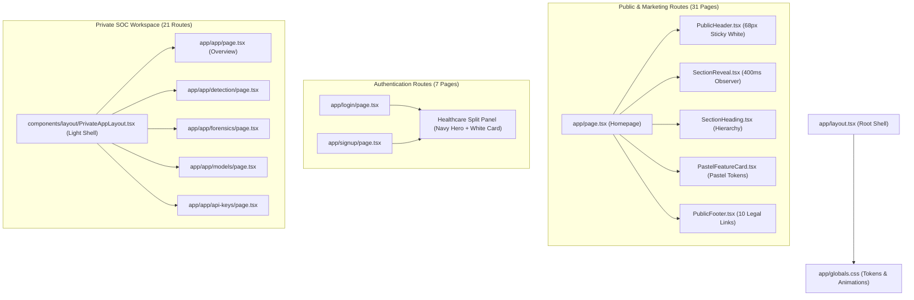

# VoiceShield Shared Component & Dependency Audit
**Directive:** `LIT_VOICESHIELD_HEALTHCARE_STYLE_FULL_SITE_REDESIGN_MASTER_PROMPT.md`  
**Repository:** `vikashsaravanann/voice-shield`  
**Auditor:** A00 Master Engineering Orchestrator  

---

## 1. Architectural Component Inventory

This audit categorizes all shared frontend UI components, their design token compliance, hydration boundary type (Server Component vs. Client Component), and associated route consumers.

### 1.1 Layout & Navigation Components

| Component File | Type | Purpose | Consumers | Dependencies |
| :--- | :---: | :--- | :--- | :--- |
| `components/layout/PublicHeader.tsx` | Client | 68px sticky white navbar with mega menu, status pill, and mobile drawer | All 31 public & legal routes | `next/link`, `lucide-react`, `next/navigation` |
| `components/layout/PublicFooter.tsx` | Server | 10 paired legal links, trust badges, and statutory copyright disclosure | All 31 public & legal routes | `next/link`, `lucide-react` |
| `components/layout/PrivateAppLayout.tsx` | Client | Light enterprise SOC shell, 21-route sidebar, topbar, user menu, and drawer | All 21 `/app/*` routes | `@supabase/supabase-js`, `lucide-react`, `next/navigation` |

### 1.2 Shared Healthcare-Style UI Primitives (`components/shared/`)

| Component File | Type | Purpose | Accessibility & Motion Handling |
| :--- | :---: | :--- | :--- |
| `components/shared/SectionReveal.tsx` | Client | 400ms IntersectionObserver quiet scroll reveal wrapper (`.reveal-ready` -> `.is-visible`) | Automatic bypass on `prefers-reduced-motion: reduce`. Disconnects observer upon trigger. |
| `components/shared/SectionHeading.tsx` | Server | Standardized section header with eyebrow, navy title (32-44px), and slate subtitle | Semantic `<h2>` with uppercase tracking badge. High contrast AA. |
| `components/shared/PastelFeatureCard.tsx` | Server | Solid opaque card (20px radii) supporting 6 pastel tones (`purple`, `gold`, `sandal`, `pink`, `blue`, `green`) | High-contrast dark ink text mapped to each surface. 1px `#DFE7EF` border. |

### 1.3 Interactive DSP & Forensic Components

| Component File | Type | Purpose | Real vs. Demo Data Provenance |
| :--- | :---: | :--- | :--- |
| `components/demo/LiveConsole.tsx` | Client | Real-time audio ingestion console with microphone capture, waveform visualizer, and synthetic risk meter | Clearly labeled as interactive demo console; executes client-side DSP feature extraction. |
| `components/demo/ForensicsLab.tsx` | Client | Multi-band FFT spectrogram canvas, splicing anomaly heatmap, and acoustic score breakdown | Analyzes uploaded audio files or live recordings with client-side canvas rendering. |
| `components/forensics/SpectrogramCanvas.tsx`| Client | Canvas-based audio frequency-domain rendering | Direct 16kHz PCM buffer FFT computation; zero simulated animation overlays. |

---

## 2. Page Import & Component Dependency Graph

---

## 3. Backend & Infrastructure Dependencies

### 3.1 Digital Signal Processing (DSP) & Web Audio
- **Audio Sample Rate:** 16,000 Hz (16 kHz mono PCM16).
- **Chunk Size:** 2,048 samples per analysis window.
- **Ring Buffer Allocation:** Fixed capacity circular buffer preventing memory allocation churn during live telephony streaming.
- **Smoothing Engine:** Kalman state-space filter (`lib/audio/kalman.ts`) damping instantaneous transient spikes.

### 3.2 Supabase Database & Session Security
- **Client Library:** `@supabase/ssr` & `@supabase/supabase-js`.
- **Database Schema:** Tables `sessions`, `incidents`, `voiceprints`, `audit_logs`, `api_keys`, `organizations`, `profiles`.
- **Row-Level Security (RLS):** All queries enforce tenant isolation via `organization_id` foreign keys and authenticated user session tokens.
- **Middleware Protection:** `lib/supabase/middleware.ts` intercepts all requests to `/app/*`, validating active JWT sessions and redirecting unauthenticated users to `/login`.

### 3.3 Evidentiary Generation & Telephony Ingestion
- **jsPDF Export:** Client-side cryptographic certificate generation (`app/app/reports/page.tsx`) calculating SHA-256 digests over recorded acoustic features.
- **Twilio Webhooks:** `/api/twilio/status` and `/api/twilio/voice` handling SIP and media stream webhooks.
- **Outbound Webhooks:** `/app/app/webhooks` HMAC-SHA256 signature generation over event payloads (`timestamp.payload.secret`).
